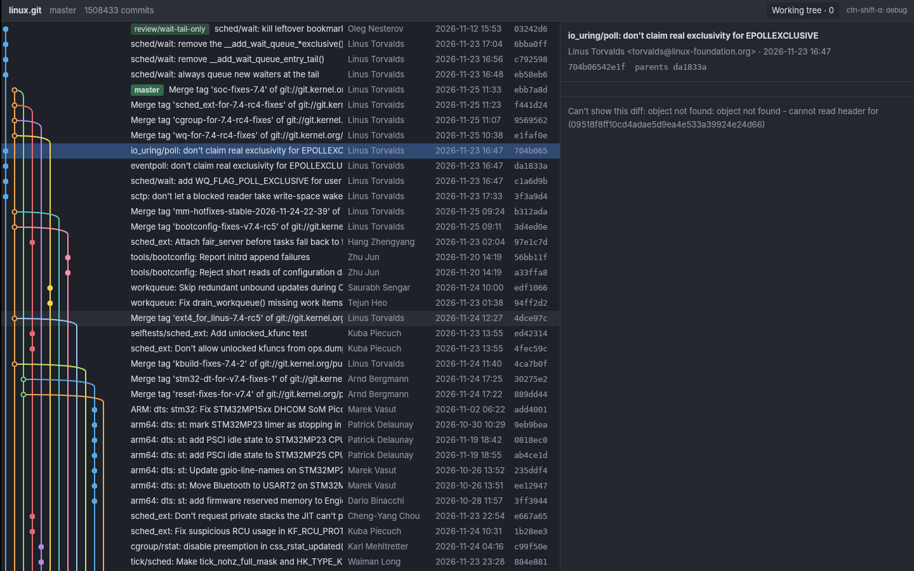
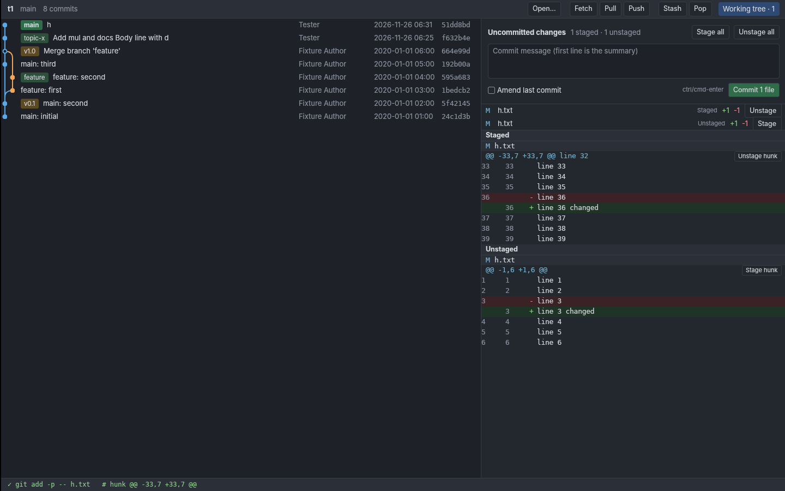

# fgc: a fast git client

A GitKraken replacement that **is** fast and **feels** fast: Rust core, libgit2 as the primary engine, gitoxide on the hottest read paths, the git CLI for network ops, and GPUI for rendering. See [`docs/PLAN.md`](docs/PLAN.md).

## Status

| Milestone | State |
|---|---|
| M0 Workspace + bench harness | Done: workspace, scripted fixture repos, criterion benches, `fgc-probe` budget gate, frame-time recorder, CI |
| M1 Core read path | Done: `GitBackend` + git2 impl (refs, paged commit walk, status, diff); linux.git first 500 commits in ~15 ms (budget 100 ms) |
| M2 Graph engine | Done: commit-graph reader, date/topo ordering, chunked incremental lane layout with reuse, background `GraphEngine`; linux.git first screen in ~24 ms, full 1.5M-commit layout in ~0.5 s in the background |
| M3 GPUI shell | Done: `fgc` window (virtualized graph, commit details, file list, diff view, working tree), keyboard navigation, debug overlay, `RepoActor`, scripted UI benchmark gated in CI |
| M4 Write path | Done (MVP scope): stage/unstage file and hunk, commit/amend (git CLI when hooks or signing are configured), branch create/checkout/delete, stash push/pop; writer thread, optimistic pending state, equivalent git command for every action |
| M5 Watcher + live status | Done: debounced file watcher → targeted status merged into the snapshot; ref changes reload the graph. Save → status 31 ms on 100k files (budget 150 ms) |
| M6 Network | Done (MVP scope): fetch/pull (ff-only)/push via the git CLI with streamed progress, credential helpers, upstream on first push |
| M7 gix experiments | Not started |
| M8 MVP polish | Not started (see [TESTING.md](TESTING.md) for what's missing) |

**Trying it out:** download a build from the Releases page and see [TESTING.md](TESTING.md). Releases are built by `.github/workflows/release.yml` when a `v*` tag is pushed.

## Layout

| Crate | Purpose |
|---|---|
| `crates/core` (`fgc-core`) | UI- and engine-agnostic data model, the `GitBackend` trait, perf budgets and `FrameRecorder` |
| `crates/git-backend` (`fgc-git-backend`) | libgit2 implementation; one `Repository` per worker thread; resumable commit walk; own commit-graph reader for full-history DAGs |
| `crates/graph` (`fgc-graph`) | Row ordering, chunked lane layout, background `GraphEngine` with progressive snapshots |
| `crates/actor` (`fgc-actor`) | `RepoActor`: owns backend + graph engine, priority worker pool, writer thread, network thread, file watcher, generation-id cancellation; UI-agnostic |
| `crates/ui` (`fgc-ui`) | GPUI shell: the `fgc` binary, views, lane painter, frame/input recorders, `--bench` mode |
| `crates/fixtures` (`fgc-fixtures`) | Fixture/benchmark repos built with the git CLI (`fast-import` for large histories) |
| `crates/bench` (`fgc-bench`) | Criterion benches and the `fgc-probe` CLI |





## Running

```sh
cargo run --release -p fgc-ui -- path/to/repo   # the app; keys and features in TESTING.md

cargo test --workspace

# Benchmark repos
cargo run --release -p fgc-fixtures -- bench-repos          # small, history-200k, wide-100k
scripts/fetch-bench-repos.sh                                # linux.git (bare, blob-less, ~2 GiB)

# Timings, optionally gated against budgets.toml
cargo run --release -p fgc-bench --bin fgc-probe -- bench-repos/linux.git \
    --budgets budgets.toml --profile linux
cargo run --release -p fgc-bench --bin fgc-probe -- . --trace   # per-call tracing spans

cargo bench -p fgc-bench --bench backend

# UI benchmark (any platform with a display; headless Linux via Xvfb + Mesa lavapipe)
scripts/ui-headless.sh ./target/release/fgc bench-repos/history-200k --bench --budgets budgets.toml --profile history-200k
```

Linux build dependencies for GPUI: `libxkbcommon-dev libxkbcommon-x11-dev libwayland-dev libvulkan-dev libx11-xcb-dev`. Headless runs also need `xvfb openbox x11-utils mesa-vulkan-drivers`.

## Measured (4-core Linux container, release build, median of 5–7)

linux.git: 1,508,433 commits, 955 refs, commit-graph file present (bare, blob-less clone).

| Measurement | linux.git | history-200k | wide-100k | Budget |
|---|---|---|---|---|
| open + refs | 6 ms | 0.5 ms | 0.1 ms | |
| walk first 500 commits | 14 ms | 3.2 ms | | 100 ms (M1) |
| **open → first screen** (graph + metadata for 60 rows) | **24 ms** | 5 ms | | 400 ms (M2) |
| open → full topology (background) | 340 ms | 31 ms | | |
| full layout complete (background) | 505 ms | 45 ms | | |
| commit DAG from commit-graph | 97 ms | 8 ms | | |
| topological sort (date order) | 172 ms | 8 ms | | |
| lane layout, all rows | 19 ms | 2 ms | | |
| geometry for a 60-row window (per frame) | 0.16 ms | 0.03 ms | | 8.3 ms frame |
| relayout after a new commit | 3.5 ms | 0.3 ms | | |
| status, targeted (1 path) | | | 2.6 ms | 150 ms |
| status, full | | 3.6 ms | 202 ms | (safety net) |
| save a file → status snapshot (watcher) | | | 31 ms | 150 ms |

Graph memory on linux.git: topology 49 MB + layout 18 MB.

### UI (M3)

`fgc --bench` drives the real window through scripted phases, one step per frame. It scrolls the graph 3 rows per frame, jumps to random positions, sends 100 key presses, opens the newest commit's diff, and scrolls that diff. Headless on this container: Xvfb + Mesa llvmpipe (software Vulkan), 4 cores.

| Measurement | linux.git | history-200k | diff-5k | Budget |
|---|---|---|---|---|
| process start → first frame | 93 ms | 108 ms | 105 ms | 300 ms |
| process start → first graph rows | 131 ms | 114 ms | | 400 ms |
| graph scroll, UI-thread CPU p99 | 6.5–8.1 ms | 6.5 ms | | 8.33 ms |
| graph scroll, wall p99 | 7.3–8.9 ms | 7.2 ms | | 16.7 ms |
| random jumps, CPU p99 | 4.0–5.1 ms | 5.3 ms | | 8.33 ms |
| key action → paint, p99 | 7.9 ms | 10.2 ms | 3.5 ms | 16 ms |
| open the 5,000-line diff (command → painted) | | | 25 ms | 100 ms |
| diff scroll, CPU p99 | | 5.5 ms | 3.9 ms | 8.33 ms |
| memory the app allocated, idle | 119 MB | 46 MB | | 150 MB |

How to read these:
- **Frame times** run from the root view's render to the end of the last paint. That's the app's CPU work for a frame; GPU time isn't included. On this machine llvmpipe does the GPU's work on the same 4 CPU cores, and profiling shows over 90% of the UI thread's samples are inside llvmpipe (mostly during present, outside the timed window). Its rasterizer threads also preempt the UI thread. So the gate uses the **UI thread's own CPU time** per frame against the 8.33 ms (120 fps) budget. Wall time is reported too, and gated at 16.7 ms (no dropped frame at 60 Hz). On linux.git the CPU p99 headroom is thin on this VM (6.5–8.1 ms across runs); the cost is GPUI's per-element work (layout, hit-testing, shaping long commit summaries for newly visible rows), not graph code.
- **Input → paint** runs from a dispatched key action to the end of the paint that shows it. It doesn't include OS input latency or waiting for the next display refresh (up to one frame).
- **Memory** is anonymous memory: what the app allocated. It excludes memory-mapped files and llvmpipe's mappings (its LLVM JIT and its "device memory", which live in VRAM on a real GPU). The report also has total RSS. On linux.git, total RSS is ~475 MB: 115 MB llvmpipe, 205 MB of libgit2's memory-mapped pack index (clean page cache the kernel can drop; `git` does the same), 15 MB binary, and the rest allocated.
- **Text** appears progressively: at most 8 rows newly gain text per frame, so a jump fills in over ~4 frames instead of one slow frame.
- No syntax highlighting yet (plan §5: tree-sitter in the background, swapped in without layout shift); the 5,000-line diff budget is met with plain text.
- The headless harness runs Xvfb with openbox (`scripts/ui-headless.sh`): without a window manager, GPUI 0.2.2 can miss the window's map event on X11 and never start its frame clock.

### How the first screen is fast